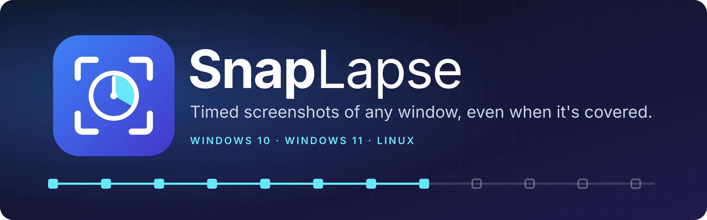

<p align="center">
  
</p>

**SnapLapse** saves a screenshot of one window on a timer, every few seconds or milliseconds, until you press Stop. It works even when other windows are on top of the one you're capturing.

## Download

Get the latest version from the [Releases page](https://github.com/Straconis/SnapLapse/releases/latest):

- **Windows 10 / 11:** `SnapLapse-<version>-setup.exe` installs SnapLapse into `Program Files\SnapLapse`, with a SnapLapse folder in the Start menu and an uninstaller. Or download `SnapLapse.exe` and run it directly, with no install.
- **Linux:** download `snaplapse-linux-x86_64`, make it executable (`chmod +x snaplapse-linux-x86_64`), and run it.

Windows may show a SmartScreen warning because the app isn't code-signed yet. Choose **More info → Run anyway**.

## How to use it

1. Choose the window to capture, such as your VTT's browser window.
2. Choose a folder for the screenshots.
3. Set how often to take one, in seconds or milliseconds.
4. Press **Start**. Press **Stop** when you're done.

Each recording gets its own folder, named with its start time and window, such as `2026-10-14 19-30-05 - Foundry VTT`, and numbering starts at 1 inside it. Set **Keep as** to **A ZIP file per recording** to have that folder packed into a ZIP file when you press Stop. For long recordings, **Split ZIP** can break it into parts of 100 MB to 4 GB (`… - part 1.zip`, `… - part 2.zip`). Each part opens on its own, and no picture is ever cut in half. Your choices are remembered for next time.

## Features

- **Captures a covered window.** Pick a window and SnapLapse keeps capturing it while other windows cover it. A minimized window can't be captured.
- **Set the interval in seconds or milliseconds.**
- **Choose the image format:** PNG, JPG or WebP.
- **Recordings never mix:** each one gets its own folder, or its own ZIP file, named with its start time.
- **Sortable file names:** files are numbered in order, like `000001 - Foundry VTT.png`.
- **Close to tray (Windows).** Clicking X hides SnapLapse to an icon by the clock and recording carries on. Click the icon to bring it back, or right-click it to stop recording or quit. You can turn this off in the app.
- **Auto-hide at a screen edge (Windows).** Turn on **Auto-hide when docked**, then drag SnapLapse against an edge of the screen. It hides when your mouse leaves and leaves a small red marker on that edge. Point at the marker to bring it back. Drag it away from the edge to undock.
- **Stays out of your way.** It never steals focus or moves windows, and it does no work between shots.
- **One small file to run.** There's nothing else to install.

## Platforms

| Platform | Notes |
|---|---|
| Windows 11 | Captures with no visible border. |
| Windows 10 | Windows draws a thin yellow border around the window being captured. |
| Linux (X11) | Captures silently. |
| Linux (Wayland) | Apps running through XWayland work now. Native Wayland apps are coming in a later version. |

## Building from source

Everything builds inside a Podman container, so the only thing you need is Podman:

```bash
./build.sh          # Linux and Windows versions plus the Windows installer, into dist/
./build.sh test     # automated tests and code checks
```

There's also a command-line mode for scripting: run `snaplapse --help`.

## License

[MIT](LICENSE)
